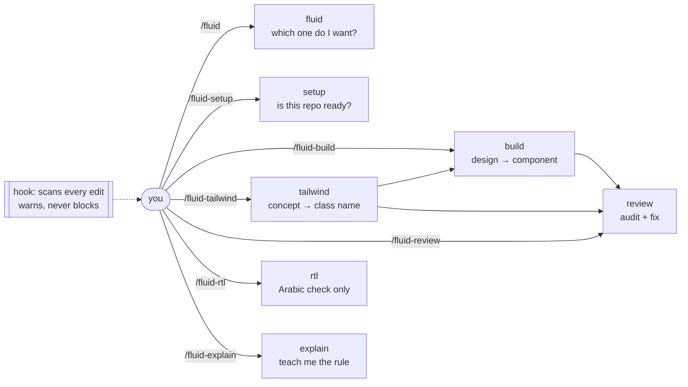

# fluid

Claude Code skills that write CSS which fits **any** screen without you guessing screen sizes, and works in Arabic without you rewriting it.

---

## The problem, in one picture

The old way: you pick a few widths and write a separate rule for each one.

```
        320px        768px        1024px       1440px
          |            |            |            |
  ┌───────┴──────┬─────┴──────┬─────┴──────┬─────┴─────┐
  │  sm: 1 col   │ md: 2 cols │ lg: 3 cols │ xl: 4 col │
  └──────────────┴────────────┴────────────┴───────────┘
          ↑            ↑            ↑
      you guessed   you guessed  you guessed
                                              ← 900px? snaps ugly. 2000px? nothing.
```

The fluid way: you describe the *rule*, once. The browser solves for every width.

```
  "each card wants at least 16rem; fit as many as you can"

  ┌────┐        ┌────┬────┐      ┌────┬────┬────┐    ┌────┬────┬────┬────┐
  │    │   →    │    │    │  →   │    │    │    │ →  │    │    │    │    │
  └────┘        └────┴────┘      └────┴────┴────┘    └────┴────┴────┴────┘
   narrow                                                          wide
                        no breakpoints. no guessing.
```

**One sentence:** *describe the rule, don't enumerate the widths.*

---

## The second problem: Arabic

Arabic reads right-to-left. Anything you pin to "left" stays pinned when the page flips.

```
  English (LTR)                    Arabic (RTL)
  ┌──────────────────┐             ┌──────────────────┐
  │ [icon] Label     │             │     Label [icon] │   ← what you want
  └──────────────────┘             └──────────────────┘
     margin-left: 8px                 ┌──────────────────┐
     ↑ works here                     │ [icon]     Label │   ← what you get
                                      └──────────────────┘
                                        margin-left is still on the LEFT
```

Fix: stop saying left/right. Say **start/end**. The browser flips them for you.

| Don't say | Say |
|---|---|
| `ml-4` `mr-4` | `ms-4` `me-4` |
| `text-left` | `text-start` |
| `left-0` | `start-0` |
| `border-l` | `border-s` |
| `padding-left` | `padding-inline-start` |

---

## What's in the box

Seven small skills, one job each.



| Command | Does |
|---|---|
| `/fluid` | Routes you to the right one |
| `/fluid-setup` | Checks your Tailwind version supports the patterns |
| `/fluid-build` | Figma link, screenshot, or description → a component |
| `/fluid-tailwind` | "what's the class for X?" for *your* Tailwind version |
| `/fluid-review` | Audits a file or diff, fixes what it finds |
| `/fluid-rtl` | Arabic-correctness only |
| `/fluid-explain` | Explains one rule, plainly |

---

## Install

```
/plugin marketplace add KhaledTaymour/fluid-skills
/plugin install fluid@fluid-skills
```

Works in every project on that machine. To update: `/plugin marketplace update fluid-skills`.

---

## The four tools it uses

Everything above reduces to these. No breakpoints needed.

```
1. INTRINSIC LAYOUT     grid auto-fit + minmax()      → columns solve themselves
2. clamp()              clamp(1rem, 2cqi, 2rem)       → sizes solve themselves
3. @container           style by parent width          → component doesn't care about the viewport
4. LOGICAL PROPS        start / end, not left / right  → Arabic solves itself
```

Breakpoints aren't banned — they're just the wrong default. Use capability queries
(`hover`, `pointer`, `prefers-reduced-motion`) for what they're actually for: asking
what the *device* can do, not how wide it is.

---

## The always-on part

One hook, installed with the plugin. After any edit to `.tsx/.jsx/.css/.scss`:

```
🌊 fluid: 2 responsive/RTL issue(s) — see /fluid-review for fixes
  Card.tsx:14  [rtl-util-margin] physical margin/padding utility
      → use logical: ms-/me- (margin), ps-/pe- (padding)
  Card.tsx:22  [mobile-100vh] full-height 100vh / h-screen
      → use min-h-dvh / min-h-svh (mobile-safe)
```

It warns. It never blocks. Exit code is always 0.

---

## Why it's built this way

`skills/fluid-shared/DECISIONS.md` — every design choice, the options weighed, and
the one-line reason. Read it before changing anything.

MIT.
