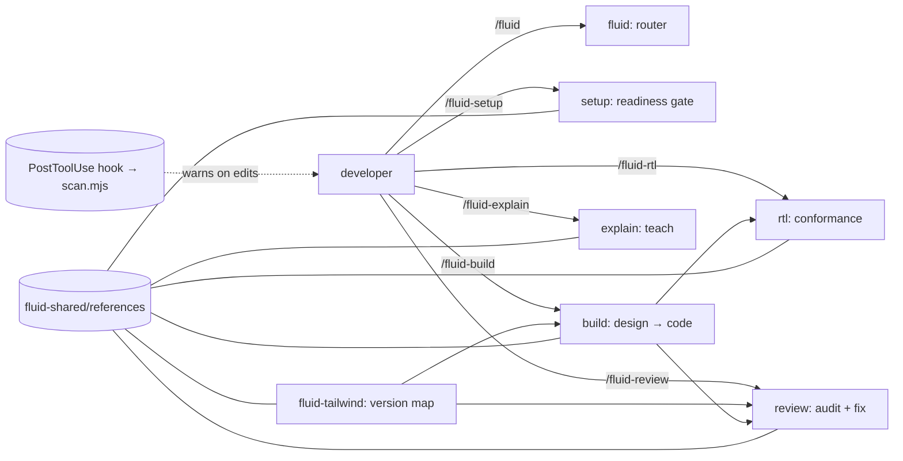

# Fluid suite — decisions (why it's shaped this way)

Plain English. Each decision is a multiple-choice question: the options we weighed, the pick (✅), and the one-line why. The reasoning travels with the suite so a future maintainer (or anyone who publishes it) sees the *why*, not just the *what*.

---

**1. Shape & count** — one big skill / one skill with modes / **a suite of small single-job skills (~7, by phase)** ✅
→ small focused skills compose and are discoverable; modes hide capability. Style follows [addyosmani/agent-skills](https://github.com/addyosmani/agent-skills) ("process, not prose").

**2. Output target** — raw CSS / Tailwind-only / **concept → Tailwind, version-aware** ✅
→ the course teaches CSS; the repo writes Tailwind. State the rule, give the Tailwind for the *detected* version.

**3. Scope** — global (just me) / both / **project-scoped + portable** ✅
→ committed so the team shares it; authored self-contained so it can be lifted to `~/.claude/skills` or published unchanged.

**4. Trigger** — auto / explicit-only / **explicit `/command` + a hook for the auto part** ✅, revised 2026-11-03 to **Claude can also start the 4 working skills** ✅
→ At first every skill ran on purpose only (`disable-model-invocation: true`), and the always-on nudge lived in the hook.
→ On 2026-11-03 fluid-build, fluid-review, fluid-rtl and fluid-tailwind dropped the flag, because sessions and subagents could not start them and tickets tell implementers to use them.
→ Their descriptions now also say when not to fire, so they still stay quiet in unrelated chat.
→ fluid, fluid-explain and fluid-setup stay explicit-only, since they are a menu, a lesson and a one-time setup check.

**5. Figma input** — MCP-only / PNG-only / link-only / **smart: a link or a file** ✅
→ `fluid-build` detects: a Figma URL → figma MCP; a file/image path → read it.

**6. Tailwind mapping** — a separate hard-coded table / v3-only / **auto-detect version + version-aware ref + verify via context7** ✅
→ utility names shift between majors (esp. container queries: v3 plugin vs v4 native); ground-truth from context7.

**7. Source of truth** — cite the repo's `docs/` / **self-contained in `fluid-shared/references/`** ✅
→ portability: no dependency on repo-internal docs, so the suite moves/publishes cleanly.

**8. Container queries** — add the plugin now / never add deps / **decide per detected version (context7)** ✅
→ native in v4; v3 needs `@tailwindcss/container-queries`. `fluid-setup` reports; don't force a dep at authoring time.

**9. Guardrail** — a CLAUDE.md prevention block / both / **an automatic Claude Code hook** ✅
→ user chose detection-after-edit over prevention-in-context. A PostToolUse hook runs `scan.mjs`, **warn-only**.

**10. Models** — all-sonnet / all-opus / inherit / **a per-skill mix** ✅
→ capability where it pays, cheap where it doesn't. Haiku `/fluid`; **Opus** `fluid-build` + `fluid-review`; Sonnet the rest. (Opus $5/$25, Sonnet $3/$15, Haiku $1/$5 per MTok.)

**11. `fluid-build` model** — plan-in-Opus/code-in-Sonnet split / **a single Opus model** ✅
→ the split is real (Claude Code "opusplan"), but design→code output is modest, so the saving is small and the orchestration complexity isn't worth it yet. Documented as a future lever.

---

## The suite

```
.claude/skills/
├── fluid/            META   — routes "which skill do I want?", links this file        (haiku)
├── fluid-setup/      GATE   — is this Tailwind repo ready? (version, CQ, logical)      (sonnet)
├── fluid-build/      BUILD  — design/desc → mobile-first, RTL-safe component           (opus)
├── fluid-tailwind/   BUILD  — concept → Tailwind for the detected version (context7)   (sonnet)
├── fluid-review/     REVIEW — audit + fix a file/diff against the rules                (opus)
├── fluid-rtl/        REVIEW — RTL-only conformance (physical → logical)                (sonnet)
├── fluid-explain/    LEARN  — teach a rule + its Tailwind mapping                      (sonnet)
└── fluid-shared/     (not a skill) DECISIONS.md · references/ · scripts/scan.mjs
```

## How they relate



## Overriding a skill's model
`model:` in a SKILL.md is **turn-scoped** (sets the model while the skill runs, then the session model resumes). Claude Code has **no per-invocation override** (no `/fluid-build --model sonnet`) and no mid-run switch. To change a skill's model: either set its `model:` to `inherit` (then pick with `/model` before invoking) or edit the `model:` line. Defaults here are intentional; flip to `inherit` if you want runtime control.
